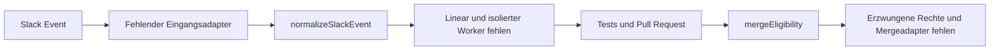

# Cloud-loop pilot: Entscheidungskern

Zwei reine Funktionen, keine Laufzeitabhängigkeiten, kein Netzwerk und keine Dienstadapter. Das Paket erstellt weder Tickets noch PRs, sendet keine Nachrichten und führt keinen Merge aus. Ziel für einen späteren Pilot ist ausschließlich das öffentliche Repository `pollography/test`; alle Beispiel-IDs und Daten sind synthetisch. Lokal entstehen keine zusätzlichen Dienstkosten; ein kostenloser Cloudbetrieb ist damit nicht nachgewiesen.

```powershell
cd ai-workshop
npm test
```

Node.js ab 22; kein `npm install` erforderlich. Bibliothek als ESM importieren:

```js
import { normalizeSlackEvent, mergeEligibility } from './index.js';
const policy = {
  teamId: 'TDEMO0001', channelIds: ['CDEMO0001'], actorIds: ['UDEMO0001'],
  repository: 'pollography/test', allowedRepositories: ['pollography/test'],
  allowedPaths: ['src/counter.js', 'src/new.js', 'src/old.js'],
  requiredChecks: ['test', 'lint'],
  baseBranch: 'main',
};
const result = normalizeSlackEvent({
  type: 'event_callback', team_id: 'TDEMO0001',
  event: { type: 'message', channel: 'CDEMO0001', user: 'UDEMO0001',
    ts: '1699999999.123456', text: '!ai-fix Fix the demo counter.' },
}, policy, 1_700_000_000_000); // synthetische Uhr, Millisekunden
console.log(result);
// Später: mergeEligibility(freshSnapshot, policy, Date.now())
```

## Aufrufervertrag

`normalizeSlackEvent(payload, policy, nowMs)` liefert `{ok:true,event}` oder `{ok:false,reason}`. Nur bereits authentifizierte Slack-Events-API-Envelopes `event_callback` / `message` zulassen. Signaturprüfung am unveränderten HTTP-Body, Replay-Zeitfenster, Limits der HTTP-Anfrage und aktuelle Berechtigungen sind Aufgaben des fehlenden Eingangsadapters. Die Funktion übernimmt keine Credentials und ersetzt diese Prüfungen nicht.

Workspace, Kanal, Actor und Repository müssen exakt der Konfiguration entsprechen. Beide Funktionen verlangen eine gültige `policy.allowedPaths`-Liste: 1 bis 200 eindeutige, sichere Dateipfade, keine Globs. Keine DMs, Bot-/App-Meldungen, Subtypen oder versteckten Meldungen. Kommando ist exakt `!ai-fix ` mit ASCII-Leerzeichen, danach eine nichtleere Aufgabe; maximal 4.000 UTF-8-Bytes einschließlich Präfix. Das Aufgabenfeld bleibt untrusted Text, wird nicht als Shell, Repository-Auswahl oder Autorisierung interpretiert und muss auch im Worker von dessen Steueranweisungen getrennt bleiben.

Normalisiertes Event: `source`, `idempotencyKey`, `teamId`, `channelId`, `actorId`, `messageTs`, `threadTs`, `repository`, `instruction`. Der Schlüssel ist SHA-256 über JSON `[team,channel,message_ts]`. Slack-Zeitstempel bleiben kanonische Sekunden-/Mikrosekunden-Strings; kein Float-Runden. `nowMs` ist eine explizite, nichtnegative sichere Integer-Epochenzeit in Millisekunden; zukünftige Nachrichten werden abgewiesen.

**Threads:** Jede neue Thread-Antwort mit Kommando erzeugt einen eigenen Schlüssel; Antwortziel bleibt die ursprüngliche `thread_ts`. Ein Root ohne `thread_ts` antwortet im eigenen Thread. Änderungen und Löschungen sind Subtypen und werden abgewiesen. Ein deterministischer Schlüssel allein verhindert keine Duplikate: der Adapter benötigt eine dauerhafte, atomare Eindeutigkeitsprüfung und die gespeicherte Zuordnung zum Ticket, Job, PR und Antwortbeleg.

`mergeEligibility(snapshot, policy, nowMs)` liefert `{eligible:false,reason}`; beim Warten zusätzlich `eligibleAtMs`; bei Eignung `{eligible:true,eligibleAtMs}`. Alle Zeiten sind explizite Integer-Millisekunden, endlich, sicher darstellbar und nicht zukünftig. Snapshot-Vertrag:

| Feld | Erforderlicher Nachweis |
| --- | --- |
| `repository`, `headRepository` | Exakter Allowlist-Treffer; im Pilot gleicher Quell-/Ziel-Owner und Repository, keine Forks |
| `pullRequestNumber`, `state` | Positive sichere Integer-ID, Zustand `open` |
| `baseBranch` | Muss exakt `policy.baseBranch` entsprechen; fehlend, ungültig oder abweichend blockiert |
| `draft`, `conflicts`, `veto`, `changeRequested` | Alle explizit `false`; fehlend oder unbekannt blockiert |
| `headSha`, `testedHeadSha`, `headUpdatedAtMs` | Identische volle 40-stellige kleingeschriebene SHA; Zeit des aktuellen Heads |
| `filesComplete`, `changedFiles` | `true`, vollständige Liste von 1 bis 200 Dateien über alle API-Seiten |
| `checks` | Exakt die konfigurierte, nichtleere Menge; keine fehlenden, doppelten oder unbekannten Checks |
| `notification` | Bestätigte Antwort für genau diese PR-ID und SHA mit nichtleerem Beleg |

`policy.baseBranch` ist zwingend: gültiger Git-Branch-Name (1–255 Zeichen, keine `..`, keine Steuerzeichen). Snapshot-`baseBranch` muss identisch sein.

Jede Datei ist `{status,path}` mit `status` aus `added`, `modified`, `removed`, `renamed`; bei Rename ist zusätzlich `previousPath` zwingend. POSIX-relative Pfade, keine Traversierung, Laufwerke, Backslashes, Prozentcodierung, leeren Komponenten oder Steuerzeichen. **Zielpfad und alter Rename-Pfad müssen exakt und einschließlich Groß-/Kleinschreibung in `policy.allowedPaths` stehen.** Ein Verzeichniseintrag erlaubt keine Unterdateien. Fehlende, leere, doppelte, überlange, unsichere oder als Glob formulierte Listen blockieren die Policy.

Zusätzlich bleiben harte Ausschlüsse aktiv, selbst wenn ein Pfad versehentlich in `allowedPaths` steht: Sicherheits-/Auth-/Secret-Pfade, CI-/Workflows, gängige Dependency-Manifeste/Locks, Deployment-/Infrastruktur-/Migrationspfade, Agent-/Hook-/Orchestrierungskonfiguration und Home-Assistant-Konfiguration. Beispiele sind `scripts/deploy.sh`, `migrations/001.sql`, `.claude/settings.json`, `.cursor/mcp.json`, `.codex/config.toml`, `.agents/skills/x.md`, `orca.yaml` und `configuration.yaml`; konkrete konservative Muster stehen in `excludedPath` in `index.js`.

Jeder Check ist `{name,status:'success',headSha,completedAtMs}`. Check-SHA muss dem aktuellen Head entsprechen; Abschluss frühestens seit dessen Änderung. Pending, skipped, neutral, failed und unknown blockieren. Gleiche Checknamen aus verschiedenen Apps sind nicht unterscheidbar: der spätere Adapter muss die erwartete vertrauenswürdige GitHub-App/Workflow-Herkunft prüfen, bevor er diesen Vertrag bildet.

Notification ist `{status:'success',headSha,pullRequestNumber,receiptId,sentAtMs}`. Sie muss nach allen aktuellen grünen Checks bestätigt worden sein. Eignung beginnt **3.600.000 ms nach dem späteren Check-/Notification-Zeitpunkt**, einschließlich exakt dieser Grenze. Ein neuer Head, erneute Checks oder eine neue Nachricht setzen die passende Wartezeit zurück; keine dauerhaften Timer werden angelegt.

## Geplanter Dienstfluss und Fehlerausgänge

Dienstfluss; nur die beiden Validierungsfunktionen sind implementiert:



1. **Slack → Normalizer:** HTTP-Signatur und Absenderberechtigung prüfen, dann normalisieren. Abgewiesen heißt keine Folgeaktion. Schlüssel atomar reservieren; Wiederholung setzt am vorhandenen Ergebnis fort.
2. **Event → Linear → Worker:** Ticket erhält Schlüssel, erlaubtes Repo und unveränderten Aufgabenbezug. Job erhält Ticket-ID und isolierten Checkout. Ticket-/Worker-Timeout oder unbekannter Ausgang: belegten Zustand abgleichen, keinen zweiten unabhängigen Job erzeugen. Budget/Grenzen, Sandbox, Tests und Abbruch müssen vor Cloudstart eingerichtet werden; dieses Paket startet nichts.
3. **Worker → Tests → PR:** Nur auf isolierter Branch arbeiten; Testergebnis an die exakte SHA binden. Bei Fehler kein Merge. PR-/Dateiliste inklusive Rename-Quellen vollständig abgleichen; unvollständige API-Seiten oder Berechtigungsfehler bleiben blockierend.
4. **PR → Slack-Antwort:** PR-Link, SHA, Testergebnis und frühesten Mergezeitpunkt im Quellthread bestätigen. Erst erfolgreicher Anbieter-Readback wird Notification-Beleg. Timeout/Fehler bleibt unbestätigt; nicht als Erfolg verbuchen. Bei nötiger Wiederholung vorhandene Nachricht anhand gespeicherter Zuordnung abgleichen.
5. **Nach einer Stunde → Entscheidung → Merge:** Kein Timer im Paket. Ein externer Aufrufer muss nach Ablauf alle maßgeblichen GitHub-/Veto-/Notification-Daten frisch lesen und erneut prüfen. Bei neuer SHA wieder testen und benachrichtigen; bei Veto/Änderungswunsch warten. Merge erst mit erwarteter SHA am GitHub-Endpunkt und tatsächlich erzwungenen Branchregeln/Least-Privilege-Berechtigungen; unmittelbar anschließender Readback für die Erfolgsnachricht.

Weder Blacklist noch reine Funktion können semantisch alle Sicherheitsänderungen oder echte GitHub-Berechtigungen garantieren. Auch eine exakt erlaubte gewöhnliche Quelldatei kann sicherheitsrelevante Logik enthalten; fachlicher Review bleibt erforderlich. Der Adapter muss die Policy aus vertrauenswürdigem Kontext außerhalb des Aufgabentexts und des vorgeschlagenen PR-Diffs laden und vollständige, frische Evidenz liefern. Eine vom Worker oder PR änderbare Allowlist ist keine Autorisierung.

Dieser reine Prädikatsaufruf kann gefälschte/veraltete Snapshots nicht erkennen, keine GitHub-Berechtigungen durchsetzen und keine Race Condition zwischen Lesen und Merge beseitigen. Die fehlenden Adapter müssen Checkherkunft, Vetoquelle, Pagination, Aktualität, Serverregeln und erwartete SHA absichern. Externe Fehler oder Zeitüberschreitungen dürfen nie in synthetische Erfolgswerte umgewandelt werden.

Lokale Abnahme: `node:test` deckt Normalfall, Duplikate/Threads, Fehl-/Missbrauchseingaben, exakte Stundengrenze, neue SHA/Rebase, unbekannte Checks, Notification-Fehler, Zeitwerte, die exakte Pfad-Allowlist samt Rename-Seiten und harte Ausschlüsse trotz versehentlicher Freigabe ab. Kein End-to-End-Dienstlauf durchgeführt. GUI und Produktionsbuild sind für diese ESM-Bibliothek ohne Dienste N/A. Unabhängiger DeepSeek-Review ist wegen Provider-HTTP429/Overload **UNKNOWN**; Lead-Codeprüfung durchgeführt; unabhängig geprüfte Dienstintegration weiterhin ausstehend.
